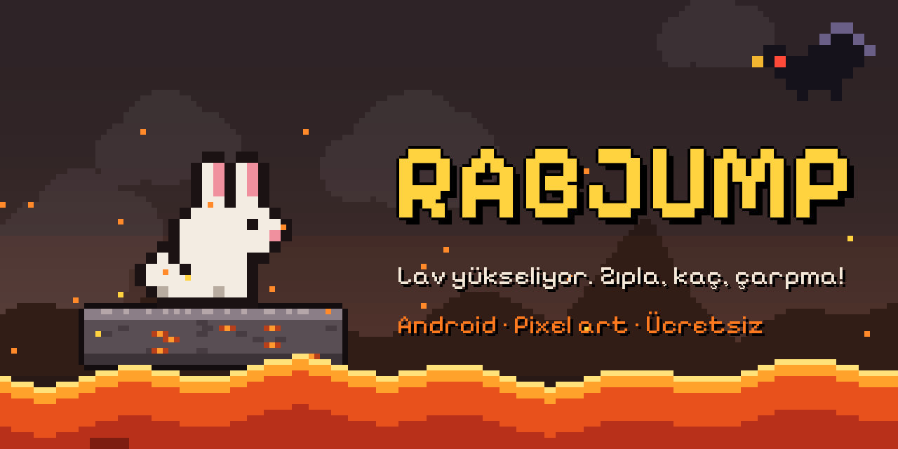

<p align="center"></p>

# RabJump

Alttan lav yükselirken basamaktan basamağa zıplayan bir tavşanla oynanan pixel art mobil oyun. Yukarı çıktıkça bölümler ve rakipler değişir; bir rakibe çarpmak ya da lava yakalanmak oyunu bitirir.

## Nasıl oynanır

- Ekranın **soluna** dokun: tavşan sol üst basamağa zıplar.
- Ekranın **sağına** dokun: tavşan sağ üst basamağa zıplar.
- Bilgisayarda **← / →** ya da **A / D** tuşları da çalışır.
- Her yeni basamak 1 puan. Puan ve en yüksek skor (HI) sol üstteki siyah yıldızlarda.

## Bölümler

| Bölüm | Başladığı basamak | Rakip |
|---|---|---|
| 1. Kül Ovası | 0 | Karga |
| 2. Kartal Kayalıkları | 40 | Kartal |
| 3. Dinozor Gökleri | 100 | Uçan dinozor |
| 4. Alev Mağarası | 180 | Alev yarasası |
| 5. Volkan Ağzı | 280 | Hepsi karışık |

Lav, puan arttıkça hızlanır.

## APK'yı indirmek

Bu repo her `main` gönderiminde APK'yı GitHub Actions ile kendisi derler.

1. Repoda **Actions** sekmesini aç ve en son **APK derle** çalışmasına tıkla.
2. Sayfanın altındaki **Artifacts** bölümünden **RabJump-apk** dosyasını indir (zip içinden `RabJump.apk` çıkar).
3. Telefona at ve kur. Android "bilinmeyen kaynak" izni isteyebilir.

Kalıcı bir indirme bağlantısı için bir etiket gönder; APK **Releases** sayfasına da eklenir:

```bash
git tag v1.0
git push origin v1.0
```

## Proje yapısı

```
web/                  Oyunun kendisi (tek HTML dosyası, internetsiz çalışır)
  index.html
  fonts/              Pixelify Sans (OFL lisanslı)
android/              Oyunu tam ekran açan küçük Android uygulaması (Java, WebView)
.github/workflows/    APK'yı otomatik derleyen iş akışı
docs/                 Kapak ve simge görselleri
```

Oyunu bilgisayarda denemek için `web/index.html` dosyasını tarayıcıda açman yeterli. Oyunda bir şey değiştirdiğinde sadece `web/` klasörünü düzenle; Android uygulaması aynı dosyayı kullanır.

Bilgisayarında Android Studio varsa `android/` klasörünü açıp doğrudan da derleyebilirsin.

## Teknik notlar

- Tüm grafikler kodla çizilen pixel art; dışarıdan resim kullanılmıyor.
- Müzik ve sesler Web Audio ile oyun içinde üretiliyor; özgün ve telifsiz.
- APK, `android/app/rabjump.keystore` anahtarıyla imzalanıyor. Bu anahtar herkese açık olduğundan sadece kişisel kurulum için uygundur. Play Store'a yüklemeden önce kendi gizli anahtarını oluştur.

## Lisans

Kod MIT lisanslı. Yazı tipi SIL Open Font License 1.1 ile lisanslı.
